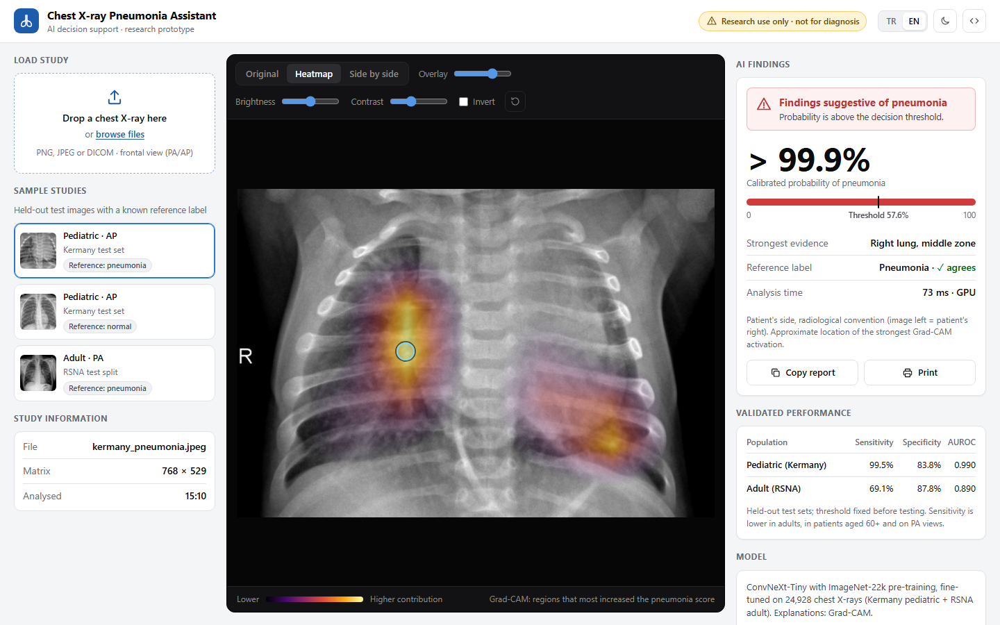
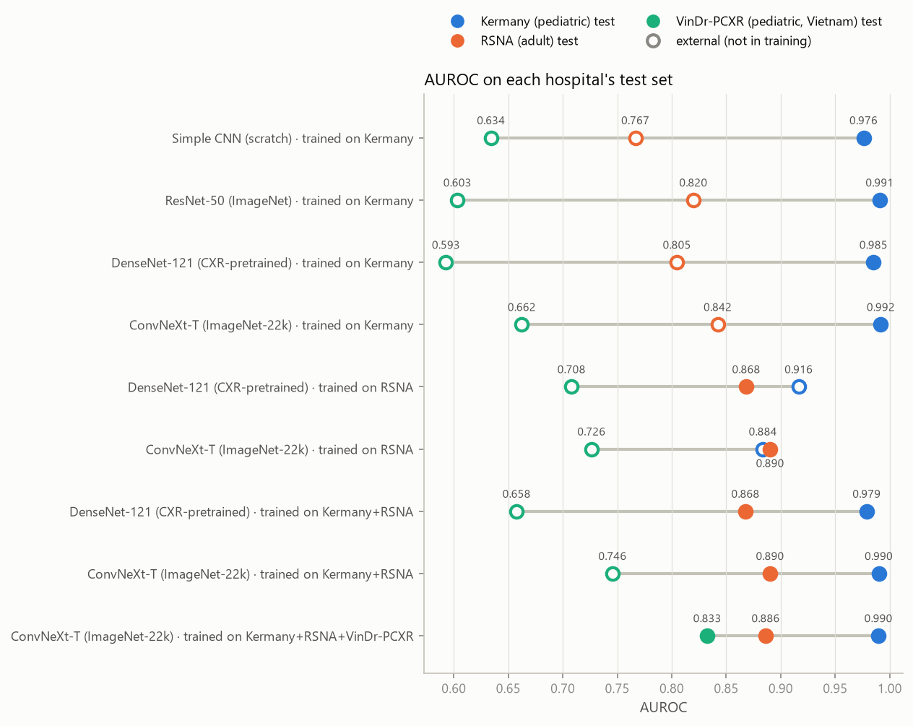
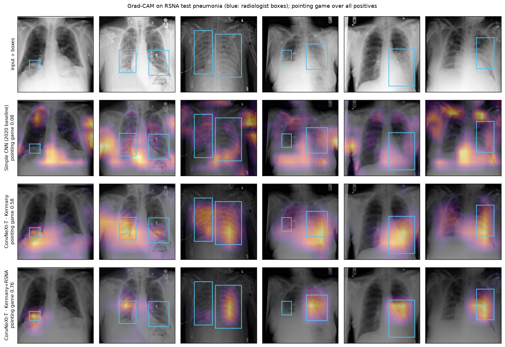
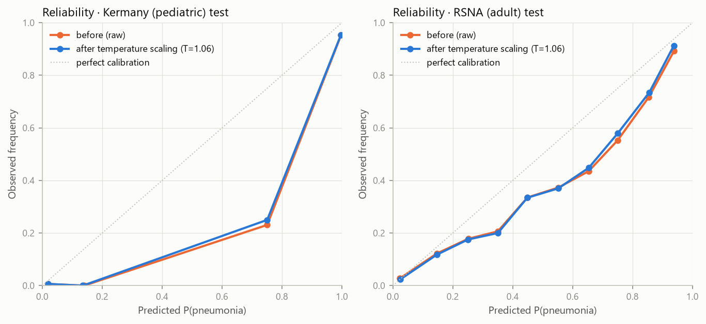
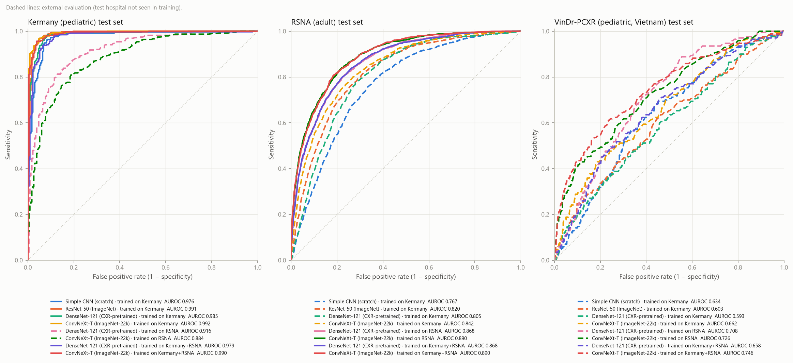
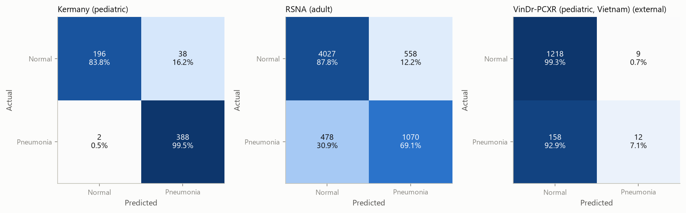
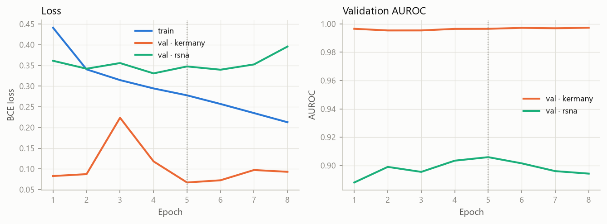
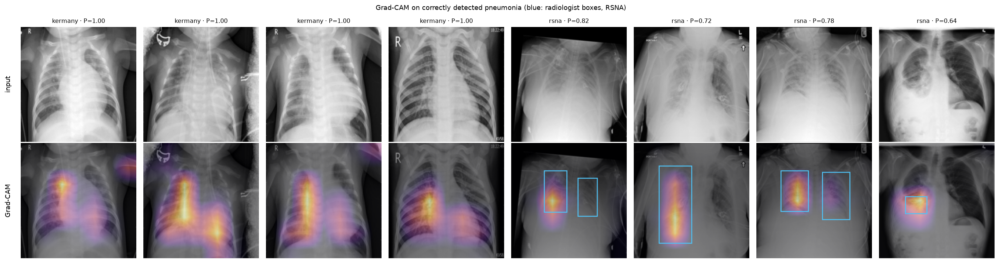

# Pneumonia Detection from Chest X-Rays

**Leakage-free, externally validated and explainable deep learning for chest radiographs, from data to a deployable API.**

[](https://huggingface.co/spaces/emir-mutlu/pneumonia-cxr-detection)
[](https://huggingface.co/emir-mutlu/pneumonia-cxr-convnext)
[](https://github.com/emir-mutlu/pneumonia-cxr-detection/actions/workflows/ci.yml)


* **One model, two hospitals**: AUROC **0.990** on pediatric X-rays (Guangzhou) and **0.890** on
  adult X-rays (NIH), with patient-level splits and patient-clustered bootstrap 95 % CIs.
* **External validation exposes domain shift**: models trained on children alone drop to AUROC
  0.77–0.84 on adults and their specificity collapses to 0.20–0.46. Multi-source training fixes it
  without losing pediatric performance.
* **A third hospital keeps it honest**: on 1,397 children from Vietnam (VinDr-PCXR, never used for
  training or tuning) the released model drops to AUROC **0.746**, and its threshold catches only
  7 % of pneumonia cases. Models trained on Chinese children transfer *worse* to Vietnamese
  children (0.59–0.66) than models trained on US adults (0.71–0.73). A new site needs its own
  data and operating point.
* **Local data and a per-site threshold close most of that gap**: adding VinDr-PCXR's training
  split raises the Vietnam AUROC to **0.833** and sensitivity from 7 % to **74 %**, keeps 0.990 /
  0.886 on the other two hospitals and cuts calibration error to about a third. The cost: Grad-CAM
  localisation drops from 77 % to 69 %.
* **Explainability measured, not just shown**: Grad-CAM peaks land inside radiologist boxes in
  **77 %** of cases (random point: 12 %). The 2020-style CNN reaches 90 % accuracy but scores
  **8 %**, worse than random. It was right for the wrong reasons.
* **Leakage found and fixed**: RSNA's 29,684 "patients" are really images of only **12,233
  patients**; splits use the true NIH patient id.
* **Runs in the browser, privately**: Grad-CAM is derived in closed form and compiled into the
  ONNX graph, so the [live demo](https://huggingface.co/spaces/emir-mutlu/pneumonia-cxr-detection)
  computes the probability and the heatmap with ONNX Runtime Web on the visitor's device. No
  X-ray is ever uploaded.
* **Deployable**: 57 MB ONNX model (fp16-stored weights, fp32 compute, identical AUROC),
  ~30 ms per image on CPU, torch-free FastAPI + Docker service, and a clinical-style web viewer
  (English / Turkish).

<picture>
  <source media="(prefers-color-scheme: dark)" srcset="reports/figures/demo_dark.png">
  
</picture>

> **Not a medical device.** Research and portfolio project; not validated for clinical use.

## Web demo

**[Open the live demo](https://huggingface.co/spaces/emir-mutlu/pneumonia-cxr-detection)**: no
install, nothing uploaded. The first visit downloads the model once (~57 MB); after that an
analysis takes about a second on a laptop.

The same viewer has two engines:

| | Live demo (static Hugging Face Space) | Local server (`pneumo demo`) |
|---|---|---|
| Inference | ONNX Runtime Web (WASM) in the browser | PyTorch on CPU / GPU behind FastAPI |
| Grad-CAM | closed form inside the ONNX graph | autograd hooks |
| Image leaves the device | never | sent to your own server only |
| Formats | PNG, JPEG | PNG, JPEG, DICOM |
| Speed | ≈0.8 s per study (laptop, single thread) | ≈60 ms (GPU), ≈0.6 s (2-core CPU) |

The browser pre-processing re-implements Pillow's grayscale conversion and anti-aliased
bilinear resampling, so the browser and Python give the same probabilities (0.9993 / 0.0064 /
0.7109 on the three sample studies in both).

```bash
pneumo demo          # local server at http://localhost:7860 (uses the released model in models/)
```

A reading-room style viewer built for clinicians rather than ML engineers:

* **Viewer**: dark PACS-like canvas with original / heatmap / side-by-side modes, overlay opacity,
  brightness, contrast and invert, and a marker on the strongest activation.
* **AI findings**: status shown with an icon and wording, not colour alone. The panel gives the
  calibrated probability, a meter with the decision threshold, a borderline warning near the
  threshold, and the strongest-evidence location in radiological convention ("right lung, lower
  zone").
* **Context for the reader**: validated sensitivity / specificity per population, known weak
  subgroups, the model version and a non-diagnostic disclaimer on every screen.
* **Workflow**: PNG / JPEG / DICOM upload, drag & drop or paste, sample studies with reference
  labels, copy-to-clipboard report, a print layout, English / Turkish and light / dark themes.

---

## Why this is not another 95 %-accuracy Kaggle notebook

Most public pneumonia classifiers are trained and tested on a single pediatric dataset, split by
image, tuned on the test set and judged by accuracy. This project starts from that 2020 baseline
and fixes each of those weaknesses:

| Common shortcut | What this project does instead |
|---|---|
| One dataset, one hospital | **Two independent training sources**: 5,856 pediatric X-rays (Guangzhou, China) and 29,684 adult X-rays (NIH, USA), plus a **third hospital used only for testing**: 1,397 pediatric X-rays (Vietnam) |
| Split by image | **Patient-level splits.** Found that RSNA's 29,684 images belong to only **12,233 patients** (75 % of images come from patients with several scans), by joining RSNA's NIH mapping file |
| 16-image validation set, threshold tuned on test | Patient-level 85/15 re-split for validation; **threshold and calibration chosen on validation only** |
| Accuracy only | AUROC, AUPRC, sensitivity, specificity, PPV/NPV, F1 with **patient-clustered bootstrap 95 % CIs** |
| In-distribution test only | **External validation** on the other hospital and age group and on a third, unseen hospital; **subgroup analysis** by sex, age and view |
| Over-confident probabilities | **Temperature scaling**, ECE and reliability diagrams |
| Hand-picked heatmaps | **Grad-CAM scored against radiologist boxes** (pointing game, energy-in-box vs. random baselines) |
| Notebook | Installable package, CLI, YAML configs, tests, CI, **ONNX export, FastAPI + Docker (torch-free), clinical web viewer** |

## Results

All numbers are on held-out test sets that were never used for training, model selection,
calibration or threshold choice. Full tables: [reports/results.md](reports/results.md).

### Released model: ConvNeXt-Tiny trained on Kermany + RSNA

| Test set | n (patients) | AUROC (95 % CI) | Sensitivity | Specificity | Accuracy | ECE |
|---|---:|---|---:|---:|---:|---:|
| Kermany (pediatric) | 624 (427) | **0.990** (0.982–0.995) | 0.995 | 0.838 | 93.6 % | 0.068 |
| RSNA (adult) | 6,133 (2,446) | **0.890** (0.877–0.903) | 0.691 | 0.878 | 83.1 % | 0.068 |
| VinDr-PCXR (pediatric, Vietnam) † | 1,397 (n/a) | 0.746 (0.702–0.789) | 0.071 | 0.993 | 88.0 % | 0.083 |

One decision threshold (0.576, chosen on validation data) is used for all populations. RSNA is
harder by construction: 59 % of its negatives are *abnormal X-rays without pneumonia*. Against
strictly normal adult X-rays the AUROC is 0.984. † VinDr-PCXR is a third hospital that no model
saw in training; its 88 % accuracy only reflects that 88 % of its children have no pneumonia.

### 1. Domain shift: trained on one hospital, tested on another



| Model | Pre-training | Train data | Params | Kermany test AUROC | RSNA test AUROC | VinDr-PCXR test AUROC | Grad-CAM pointing game |
|---|---|---|---:|---|---|---|---:|
| Simple CNN (2020 baseline) | none | Kermany | 1.2 M | 0.976 (0.963–0.986) | 0.767 (0.748–0.784) † | 0.634 (0.592–0.673) † | 0.08 |
| ResNet-50 | ImageNet-1k | Kermany | 23.5 M | 0.991 (0.984–0.996) | 0.820 (0.803–0.835) † | 0.603 (0.554–0.647) † | 0.44 |
| DenseNet-121 | chest X-rays (CheXpert) | Kermany | 6.9 M | 0.985 (0.975–0.992) | 0.805 (0.790–0.819) † | 0.593 (0.543–0.640) † | 0.48 |
| ConvNeXt-Tiny | ImageNet-22k | Kermany | 27.8 M | **0.992** (0.985–0.997) | 0.842 (0.826–0.858) † | 0.662 (0.615–0.705) † | 0.58 |
| DenseNet-121 | chest X-rays (CheXpert) | RSNA | 6.9 M | 0.916 (0.890–0.938) † | 0.868 (0.853–0.883) | 0.708 (0.670–0.743) † | 0.38 |
| ConvNeXt-Tiny | ImageNet-22k | RSNA | 27.8 M | 0.884 (0.851–0.911) † | **0.890** (0.877–0.903) | 0.726 (0.687–0.767) † | 0.67 |
| DenseNet-121 | chest X-rays (CheXpert) | Kermany + RSNA | 6.9 M | 0.979 (0.966–0.989) | 0.868 (0.853–0.883) | 0.658 (0.614–0.699) † | 0.40 |
| **ConvNeXt-Tiny** | ImageNet-22k | **Kermany + RSNA** | 27.8 M | 0.990 (0.982–0.995) | **0.890** (0.877–0.903) | **0.746** (0.702–0.789) † | **0.76** |
| ConvNeXt-Tiny | ImageNet-22k | Kermany + RSNA + VinDr-PCXR | 27.8 M | 0.990 (0.982–0.995) | 0.886 (0.873–0.899) | **0.833** (0.802–0.863) | 0.69 |

† external: that hospital and age group were never seen in training. VinDr-PCXR (Vietnam,
children under 10) is external for every model. Pointing game: share of RSNA test pneumonia
images whose Grad-CAM peak falls inside a radiologist box; a random point scores 0.12.

* **Every single-hospital model looks excellent at home and degrades abroad.** Kermany-only models
  lose 0.15–0.21 AUROC on adults. At the threshold tuned on pediatric validation data they flag
  most adults as pneumonia (sensitivity 0.94–0.98, specificity 0.20–0.46), and their calibration
  error rises from 0.03–0.08 to 0.40–0.53.
* **The shift goes both ways.** Adult-only models reach 0.88–0.92 on children, against 0.985–0.992
  for models trained on children. At its adult-tuned threshold the RSNA-only ConvNeXt misses 24 % of
  pediatric pneumonia (sensitivity 0.762).
* **Multi-source training gets the best of both.** ConvNeXt trained on both sources matches each
  single-hospital specialist on its own ground (0.990 vs 0.992 pediatric, 0.890 vs 0.890 adult) and
  localises better than either (pointing game 0.76 vs 0.58 and 0.67).
* **Chest X-ray pre-training did not beat a strong ImageNet-22k ConvNet** here: DenseNet-121 with
  CheXpert weights is 4× smaller but trails ConvNeXt-T by 0.01–0.04 AUROC in five of six
  comparisons; the exception is adult → child transfer (0.916 vs 0.884).
* **A third hospital lowers every model.** On VinDr-PCXR (Phu Tho, Vietnam; 1,397 children,
  median age 1 year; pneumonia includes broncho-pneumonia, and bronchitis or bronchiolitis
  count as negatives) all eight models score 0.59–0.75:
  * **Same age group is not enough.** Models trained on Kermany children score 0.59–0.66, below
    the adult-only models (0.71–0.73). They learned Guangzhou-specific cues, not "pediatric
    pneumonia".
  * **The released model still ranks best (0.746), but its threshold does not transfer.** Its
    calibrated probabilities are low for these children (median 0.034 for pneumonia cases), so
    at 0.576 it finds 7 % of them. Catching 80 % would need a threshold of 0.012, at a
    specificity of 0.50.
  * **The youngest children are hardest**: AUROC 0.681 under one year vs 0.774 at 1–4 years
    (Kermany covers ages 1–5). Full table: [reports/results.md](reports/results.md).
* **What a hospital would do next, simulated: train on its own data and set its own threshold.**
  The same recipe on all three sources (VinDr-PCXR's official training split added, 15 % of it
  held out for validation), with a Youden threshold per site:

  | Test set | Released model (2 sites) | 3-site model | Sens / Spec, released → 3-site |
  |---|---|---|---|
  | Kermany | 0.990 | 0.990 | 0.995 / 0.838 → 0.992 / 0.885 |
  | RSNA | 0.890 | 0.886 | 0.691 / 0.878 → 0.845 / 0.755 |
  | VinDr-PCXR | 0.746 † | **0.833** | 0.071 / 0.993 → **0.735 / 0.759** |

  * Infants under one year improve most (0.681 → 0.796), and calibration error falls from
    0.068–0.083 to 0.021–0.030.
  * Grad-CAM localisation on RSNA drops from 0.765 to 0.690 (random: 0.124); the model spends
    capacity on a third label definition.
  * The VinDr-PCXR result is now in-distribution, not external. The dataset has no patient ids,
    so the same child could appear in its official training and test splits.
  * The released model stays the 2-site one, trained on public data only. The PhysioNet
    license is silent on sharing models trained on its restricted data, so these weights are
    not published.

### 2. Explainability, evaluated against radiologists



The model never saw a bounding box during training (image-level labels only), yet the released
model's Grad-CAM peak lands inside a radiologist box for **76.5 %** of the 1,548 RSNA test
pneumonia images, and 48 % of its CAM mass falls inside boxes that cover 12 % of the image. The
2020-style CNN trained from scratch scores 8.2 %, *below* the 12.4 % of a random point: it reaches
90 % accuracy on its own test set by looking at image borders, ribs and the abdomen, which explains
why it collapses on another hospital.

### 3. Calibration and operating point



* **Single-source models are close to calibrated in-distribution** (ECE ≤ 0.08). Temperature
  scaling helps most where it is needed: the RSNA-only ConvNeXt goes from ECE 0.060 to 0.019.
* **One temperature cannot serve two populations.** The released model is fitted on pooled
  validation data from sources with 73 % and 24 % prevalence (T = 1.06). Its ECE stays at 0.068,
  and on adults its probabilities between 0.6 and 0.9 are too high. Per-site recalibration would be
  the next step.
* **Calibration fails completely across hospitals**: a probability from a Kermany-only model means
  much less on an adult X-ray (ECE 0.40–0.53).
* **The same holds for the decision threshold.** One global threshold gives sensitivity 0.995 in
  Guangzhou children, 0.691 in US adults and 0.071 in Vietnamese children, so any new site needs
  its own validation and operating point.

### 4. Subgroups (RSNA test set, released model)

| Subgroup | n | Prevalence | AUROC | Sensitivity | Specificity |
|---|---:|---:|---:|---:|---:|
| Female | 2,643 | 0.23 | 0.891 | 0.636 | 0.900 |
| Male | 3,490 | 0.27 | 0.888 | 0.726 | 0.860 |
| Age < 40 | 1,734 | 0.29 | 0.904 | 0.737 | 0.877 |
| Age 40–59 | 2,837 | 0.26 | 0.895 | 0.704 | 0.878 |
| Age ≥ 60 | 1,561 | 0.20 | 0.854 | 0.591 | 0.879 |
| PA view | 3,223 | 0.10 | 0.861 | 0.394 | 0.958 |
| AP view | 2,910 | 0.42 | 0.847 | 0.769 | 0.740 |

* No sex gap; performance drops for patients aged 60 and over.
* **Acquisition shortcut warning**: AP (often bedside) images have 4× the prevalence of PA images.
  AUROC within each view (0.85–0.86) is lower than the pooled 0.89, so part of the pooled score
  comes from recognising the view rather than the disease.

<details>
<summary>More figures: ROC curves, confusion matrices, training curves, Grad-CAM examples</summary>






</details>

## Data

| | Kermany et al. (Guangzhou) | RSNA Pneumonia Challenge 2018 (NIH) | VinDr-PCXR (Vietnam), test only |
|---|---|---|---|
| Population | children aged 1–5 | adults (median age 49) | children under 10 (median 1 year) |
| Images / patients | 5,856 / 3,288 | 29,684 / 12,233 | 9,125 / no patient ids (test: 1,397) |
| Positive class | pneumonia (73 %) | lung opacity (24 %) | pneumonia incl. broncho-pneumonia (12 %) |
| Extra | bacterial / viral subtype | radiologist boxes, sex, age, PA/AP view | sex, age, 11 other diagnoses |
| License | CC BY 4.0 | RSNA terms of use (attribution) | PhysioNet Restricted Health Data License 1.5.0 (sign the DUA; never redistributed) |

Patient-level, label-stratified splits: Kermany official test set kept, train/val re-split 85/15;
RSNA 70/10/20; VinDr-PCXR official test set. Details, split tables, data-quality findings and
required citations: [docs/DATASETS.md](docs/DATASETS.md).

## Method

* **Models**: a small CNN trained from scratch (the original 2020 idea), ResNet-50 and
  ConvNeXt-Tiny with ImageNet pre-training ([timm](https://github.com/huggingface/pytorch-image-models)),
  and DenseNet-121 pre-trained on chest X-rays (CheXpert weights from
  [TorchXRayVision](https://github.com/mlmed/torchxrayvision)). Input normalisation lives inside
  the model, so every model, the ONNX graph and the API take the same `[0, 1]` grayscale tensor.
* **Training**: AdamW, linear warm-up + cosine decay, bf16 autocast, gradient clipping,
  anatomically plausible augmentation (no horizontal flips), early stopping on validation AUROC.
  With several sources the selection metric is the *mean of per-source* AUROCs, so the model is
  not rewarded for telling hospitals apart.
* **Calibration and operating point**: temperature scaling and a Youden-optimal threshold,
  both fitted on validation data only and frozen before any test set is touched.
* **Evaluation**: test metrics with patient-clustered bootstrap CIs (1,000 resamples), ECE before
  and after calibration, subgroup metrics, and the RSNA "Lung Opacity vs. strictly Normal" view.
* **Explainability**: Grad-CAM on the last feature map; on all RSNA test positives we measure
  whether the CAM peak lands inside a radiologist box (pointing game) and how much CAM mass
  falls inside the boxes, each against the score of an uninformative map.
* **Serving**: ONNX export (opset 18, dynamic batch, calibration folded into the graph, parity
  check against PyTorch), torch-free `OnnxPredictor`, FastAPI service accepting PNG/JPEG/DICOM,
  slim Docker image, and a FastAPI + vanilla JS web viewer that computes Grad-CAM on a single
  dedicated model thread (≈60 ms per study on GPU).
* **In-browser inference**: for pooled heads (ConvNeXt: pool → LayerNorm → linear; ResNet:
  pool → linear) the gradient of the logit with respect to the last feature map is constant over
  space, so the Grad-CAM weights have a closed form (verified to 2·10⁻⁷ against autograd). The
  `pneumo export-browser` graph returns probability and heatmap in one forward pass and runs in
  ONNX Runtime Web. `scripts/deploy_space.py` publishes the model repo and the static Space.

## Quickstart

```bash
git clone https://github.com/emir-mutlu/pneumonia-cxr-detection.git
cd pneumonia-cxr-detection
python -m venv .venv && source .venv/bin/activate        # Windows: .venv\Scripts\activate
pip install torch torchvision --index-url https://download.pytorch.org/whl/cu128   # or /whl/cpu
pip install -e ".[data,xrv,serve,dev]"
```

**Use the released model** (in `models/`, no dataset needed):

```bash
pneumo predict app/examples/kermany_pneumonia.jpeg      # ONNX Runtime, CPU
pneumo demo                                              # web viewer with Grad-CAM at http://localhost:7860
uvicorn app.api:app --port 8000                          # REST API, docs at http://localhost:8000/docs
curl -F "file=@app/examples/rsna_lung_opacity.png" localhost:8000/predict
```

**Docker** (torch-free image, ONNX Runtime + FastAPI):

```bash
docker build -t pneumonia-cxr .
docker run -p 8000:8000 pneumonia-cxr
```

**Reproduce the released model** (≈5.2 GB download; ≈15 min training on an RTX 3060 laptop GPU):

```bash
pneumo download all            # Kermany (Hugging Face mirror) + RSNA (official RSNA site)
pneumo prepare all             # decode, resize, patient-level splits
pneumo train configs/multi_convnext_tiny.yaml
pneumo evaluate runs/multi_convnext_tiny
pneumo explain  runs/multi_convnext_tiny
pneumo report --featured multi_convnext_tiny
pneumo export   runs/multi_convnext_tiny
```

`scripts/reproduce.sh` runs all eight configurations in `configs/` (≈2.5 h). Add `--mlflow` to `pneumo train`
to track runs with MLflow (`pip install -e ".[track]"`).

**Third-hospital test (optional, needs your own PhysioNet access)**: sign the data use agreement
on [VinDr-PCXR](https://physionet.org/content/vindr-pcxr/), download the ZIP from its Files
section, then:

```bash
pneumo physionet-import vindr-pcxr-...-1.0.0.zip --project vindr-pcxr   # extract + verify SHA-256
pneumo prepare vindr_pcxr
pneumo evaluate runs/* --source vindr_pcxr
pneumo train configs/multi3_convnext_tiny.yaml   # optional: the 3-site model (≈20 min)
```

Without it, every command simply skips this test set.

## Project structure

```
├── app/
│   ├── api.py               FastAPI service (ONNX Runtime, no PyTorch)
│   ├── web.py               web demo backend: analysis + Grad-CAM endpoint
│   ├── static/              viewer UI (HTML, CSS, JS) + in-browser ONNX engine
│   └── examples/            three held-out test images (with attribution)
├── configs/                 one YAML per experiment
├── deploy/huggingface/      cards for the static Space, the model repo and a Docker Space
├── docs/DATASETS.md         sources, licenses, splits, data-quality findings
├── models/                  released model: model.onnx, model.pt, model_meta.json
├── reports/                 generated results.md, results.json and figures
├── src/pneumonia_cxr/
│   ├── data/                download, PhysioNet import, Kermany / RSNA / VinDr-PCXR preparation, splits
│   ├── models.py            model zoo with built-in input normalisation
│   ├── train.py             training loop, calibration, threshold selection
│   ├── evaluate.py          test metrics, bootstrap CIs, subgroups
│   ├── metrics.py           metrics, ECE, temperature scaling
│   ├── gradcam.py           Grad-CAM and localisation scores
│   ├── explain.py           pointing game vs radiologist boxes, figures
│   ├── export.py            ONNX export with parity check
│   ├── inference.py         torch-free ONNX predictor
│   ├── report.py            tables and figures
│   └── cli.py               `pneumo` command line
├── scripts/                 reproduce.sh, deploy_space.py
├── tests/                   pytest suite (splits, metrics, models, Grad-CAM, ONNX, API, web demo)
├── Dockerfile
└── pyproject.toml
```

## Limitations

* Two training sources are a narrow view of real-world variation (scanners, protocols,
  populations). The third-hospital test shows the cost: AUROC 0.746 and a threshold that does
  not transfer. Local training data and a per-site threshold recover much of it (0.833), which is
  the argument for validating and tuning at every new site.
* VinDr-PCXR has no patient identifiers, so its CIs are image-level, and each image was read by
  one radiologist.
* Kermany labels are image-level diagnoses from two physicians; RSNA labels mark *lung opacity
  suggestive of pneumonia*, not confirmed pneumonia. The two label definitions differ.
* AP views and portable markers correlate with disease in RSNA; the model may partly use such
  acquisition cues (see the view subgroup table).
* Grad-CAM shows where evidence is located, not why; a good pointing-game score does not
  prove clinically correct reasoning.

## Acknowledgements and citations

Kermany et al., Cell 2018 and Mendeley Data V2 (CC BY 4.0); NIH Clinical Center ChestX-ray14
(Wang et al., CVPR 2017); RSNA-STR Pneumonia Detection Challenge annotations (Shih et al.,
Radiology: AI 2019); VinDr-PCXR (Pham, Tran & Nguyen, PhysioNet 2022) and PhysioNet;
TorchXRayVision (Cohen et al., MIDL 2022). Full references in [docs/DATASETS.md](docs/DATASETS.md).

## License

Code: MIT © 2020–2026 Emir Mutlu. Datasets keep their own licenses; model weights are released
for research and education only.
